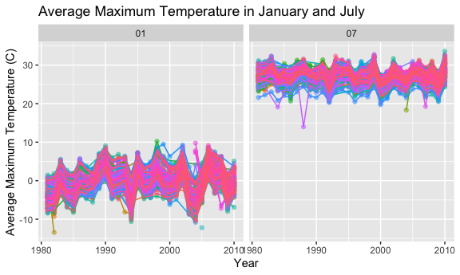
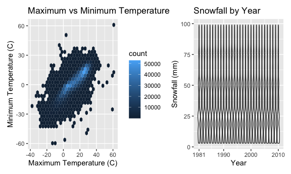
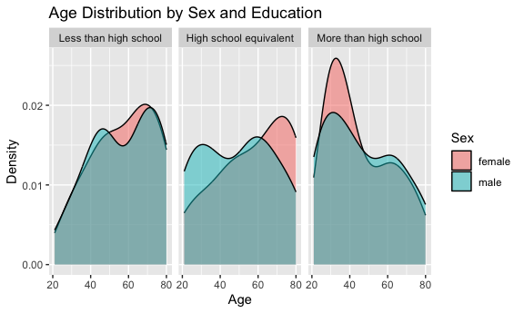
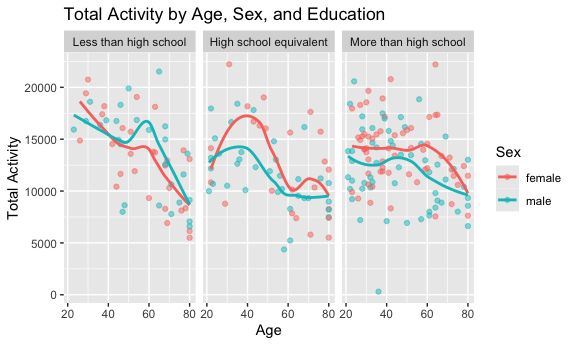
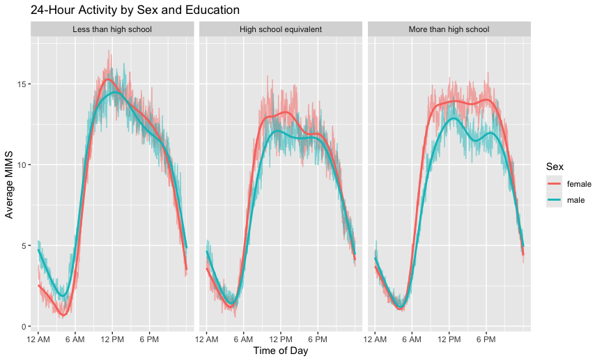
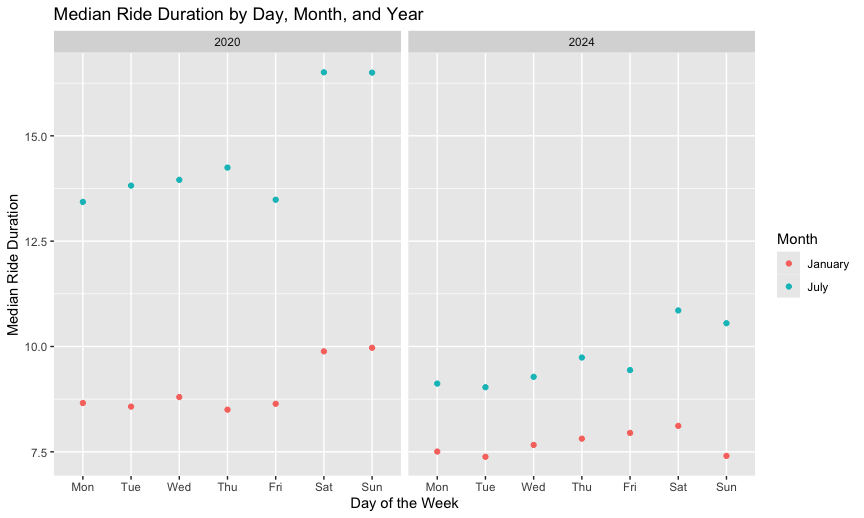
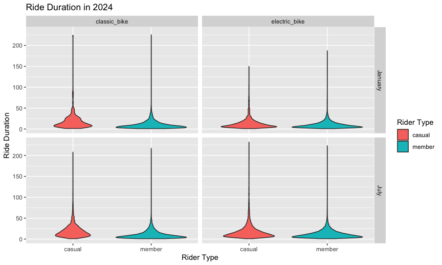

Homework 3
================
Karthika Shankar
2026-10-19

# Problem 1

``` r
data("ny_noaa")
```

``` r
ny_noaa
```

    ## # A tibble: 2,595,176 × 7
    ##    id          date        prcp  snow  snwd tmax  tmin 
    ##    <chr>       <date>     <int> <int> <int> <chr> <chr>
    ##  1 US1NYAB0001 2007-11-01    NA    NA    NA <NA>  <NA> 
    ##  2 US1NYAB0001 2007-11-02    NA    NA    NA <NA>  <NA> 
    ##  3 US1NYAB0001 2007-11-03    NA    NA    NA <NA>  <NA> 
    ##  4 US1NYAB0001 2007-11-04    NA    NA    NA <NA>  <NA> 
    ##  5 US1NYAB0001 2007-11-05    NA    NA    NA <NA>  <NA> 
    ##  6 US1NYAB0001 2007-11-06    NA    NA    NA <NA>  <NA> 
    ##  7 US1NYAB0001 2007-11-07    NA    NA    NA <NA>  <NA> 
    ##  8 US1NYAB0001 2007-11-08    NA    NA    NA <NA>  <NA> 
    ##  9 US1NYAB0001 2007-11-09    NA    NA    NA <NA>  <NA> 
    ## 10 US1NYAB0001 2007-11-10    NA    NA    NA <NA>  <NA> 
    ## # ℹ 2,595,166 more rows

``` r
str(ny_noaa)
```

    ## tibble [2,595,176 × 7] (S3: tbl_df/tbl/data.frame)
    ##  $ id  : chr [1:2595176] "US1NYAB0001" "US1NYAB0001" "US1NYAB0001" "US1NYAB0001" ...
    ##  $ date: Date[1:2595176], format: "2007-11-01" "2007-11-02" ...
    ##  $ prcp: int [1:2595176] NA NA NA NA NA NA NA NA NA NA ...
    ##  $ snow: int [1:2595176] NA NA NA NA NA NA NA NA NA NA ...
    ##  $ snwd: int [1:2595176] NA NA NA NA NA NA NA NA NA NA ...
    ##  $ tmax: chr [1:2595176] NA NA NA NA ...
    ##  $ tmin: chr [1:2595176] NA NA NA NA ...
    ##  - attr(*, "spec")=
    ##   .. cols(
    ##   ..   id = col_character(),
    ##   ..   date = col_date(format = ""),
    ##   ..   prcp = col_integer(),
    ##   ..   snow = col_integer(),
    ##   ..   snwd = col_integer(),
    ##   ..   tmax = col_character(),
    ##   ..   tmin = col_character()
    ##   .. )

``` r
ny_noaa |>
  summarize(
    missing_prcp = mean(is.na(prcp)),
    missing_snow = mean(is.na(snow)),
    missing_snwd = mean(is.na(snwd)),
    missing_tmax = mean(is.na(tmax)),
    missing_tmin = mean(is.na(tmin))
  )
```

    ## # A tibble: 1 × 5
    ##   missing_prcp missing_snow missing_snwd missing_tmax missing_tmin
    ##          <dbl>        <dbl>        <dbl>        <dbl>        <dbl>
    ## 1       0.0562        0.147        0.228        0.437        0.437

The ny_noaa dataset has 2,595,176 observations and 7 variables. It
includes the station ID, date, precipitation, snowfall, snow depth,
maximum temperature, and minimum temperature. The date variable is
stored as a date, precipitation, snowfall, and snow depth are stored as
integers, and id, maximum, and minimum temperature are stored as
character variables. There is a decent amount of missing data mostly for
temperature, about 5.6% of precipitation values are missing, 14.7% of
snowfall values are missing, 22.8% of snow depth values are missing, and
about 43.7% of both maximum and minimum temperature values are missing.

``` r
ny_noaa =
  ny_noaa |>
  separate(
    date,
    into = c("year", "month", "day"),
    sep = "-"
  )
```

``` r
ny_noaa
```

    ## # A tibble: 2,595,176 × 9
    ##    id          year  month day    prcp  snow  snwd tmax  tmin 
    ##    <chr>       <chr> <chr> <chr> <int> <int> <int> <chr> <chr>
    ##  1 US1NYAB0001 2007  11    01       NA    NA    NA <NA>  <NA> 
    ##  2 US1NYAB0001 2007  11    02       NA    NA    NA <NA>  <NA> 
    ##  3 US1NYAB0001 2007  11    03       NA    NA    NA <NA>  <NA> 
    ##  4 US1NYAB0001 2007  11    04       NA    NA    NA <NA>  <NA> 
    ##  5 US1NYAB0001 2007  11    05       NA    NA    NA <NA>  <NA> 
    ##  6 US1NYAB0001 2007  11    06       NA    NA    NA <NA>  <NA> 
    ##  7 US1NYAB0001 2007  11    07       NA    NA    NA <NA>  <NA> 
    ##  8 US1NYAB0001 2007  11    08       NA    NA    NA <NA>  <NA> 
    ##  9 US1NYAB0001 2007  11    09       NA    NA    NA <NA>  <NA> 
    ## 10 US1NYAB0001 2007  11    10       NA    NA    NA <NA>  <NA> 
    ## # ℹ 2,595,166 more rows

``` r
ny_noaa =
  ny_noaa |>
  mutate(
    prcp = prcp / 10,
    tmax = as.numeric(tmax) / 10,
    tmin = as.numeric(tmin) / 10
  )
```

``` r
ny_noaa |>
  count(snow) |>
  arrange(desc(n))
```

    ## # A tibble: 282 × 2
    ##     snow       n
    ##    <int>   <int>
    ##  1     0 2008508
    ##  2    NA  381221
    ##  3    25   31022
    ##  4    13   23095
    ##  5    51   18274
    ##  6    76   10173
    ##  7     8    9962
    ##  8     5    9748
    ##  9    38    9197
    ## 10     3    8790
    ## # ℹ 272 more rows

The most common snowfall value is 0 mm which makes sense because most
days do not have any snowfall. The other common values are: 25, 13, 51,
and 76 mm. These values probably occur often because snowfall was
originally recorded in common inch amounts and then converted to
millimeters.

``` r
ny_noaa_monthly =
  ny_noaa |>
  filter(month == "01" | month == "07") |>
  drop_na(tmax) |>
  mutate(
    year = as.numeric(year)
  ) |>
  group_by(id, year, month) |>
  summarize(
    mean_tmax = mean(tmax)
  )
```

    ## `summarise()` has regrouped the output.
    ## ℹ Summaries were computed grouped by id, year, and month.
    ## ℹ Output is grouped by id and year.
    ## ℹ Use `summarise(.groups = "drop_last")` to silence this message.
    ## ℹ Use `summarise(.by = c(id, year, month))` for per-operation grouping
    ##   (`?dplyr::dplyr_by`) instead.

``` r
ny_noaa_monthly |>
  ggplot(aes(x = year, y = mean_tmax, color = id)) +
  geom_point(alpha = .5) +
  geom_line() +
  facet_grid(. ~ month) +
  labs(
    title = "Average Maximum Temperature in January and July",
    x = "Year",
    y = "Average Maximum Temperature (C)"
  ) +
  theme(legend.position = "none")
```



January temperatures vary a lot more across stations and years than July
temperatures. Most January averages are around or below 0°C and July
averages are mostly in the mid to upper 20s. There are also a few
noticeable outliers, including some very cold January averages and a few
low July averages.

``` r
ggp_tmax_tmin =
  ny_noaa |>
  drop_na(tmax, tmin) |>
  ggplot(aes(x = tmax, y = tmin)) +
  geom_hex() +
  labs(
    title = "Maximum vs Minimum Temperature",
    x = "Maximum Temperature (C)",
    y = "Minimum Temperature (C)"
  )
```

``` r
ggp_snow =
  ny_noaa |>
  filter(
    snow > 0,
    snow < 100
  ) |>
  mutate(
    year = as.numeric(year)
  ) |>
  ggplot(aes(x = year, y = snow)) +
  geom_violin(aes(group = year)) +
  scale_x_continuous(
    breaks = c(1981, 1990, 2000, 2010)
  ) +
  labs(
    title = "Snowfall by Year",
    x = "Year",
    y = "Snowfall (mm)"
  )
```

``` r
ggp_tmax_tmin + ggp_snow
```



Maximum and minimum temperature have a strong positive relationship,
with most observations concentrated on a diagonal pattern. There are
also a few outlier temperature values. The snowfall distributions are
pretty similar across years where most snowfall values below 100 mm
concentrated at several common amounts and no major change in the
overall distribution over time.

# Problem 2

``` r
nhanes_covar_df =
  read_csv(
    "./data/nhanes_covar.csv",
    skip = 4
  )
```

    ## Rows: 250 Columns: 5
    ## ── Column specification ────────────────────────────────────────────────────────
    ## Delimiter: ","
    ## dbl (5): SEQN, sex, age, BMI, education
    ## 
    ## ℹ Use `spec()` to retrieve the full column specification for this data.
    ## ℹ Specify the column types or set `show_col_types = FALSE` to quiet this message.

``` r
nhanes_covar_df
```

    ## # A tibble: 250 × 5
    ##     SEQN   sex   age   BMI education
    ##    <dbl> <dbl> <dbl> <dbl>     <dbl>
    ##  1 62161     1    22  23.3         2
    ##  2 62164     2    44  23.2         3
    ##  3 62169     1    21  20.1         2
    ##  4 62174     1    80  33.9         3
    ##  5 62177     1    51  20.1         2
    ##  6 62178     1    80  28.5         2
    ##  7 62180     1    35  27.9         3
    ##  8 62184     1    26  22.1         2
    ##  9 62186     2    17  22.9        NA
    ## 10 62189     2    30  22.4         3
    ## # ℹ 240 more rows

``` r
nhanes_covar_df =
  nhanes_covar_df |>
  janitor::clean_names()
```

``` r
nhanes_covar_df =
  nhanes_covar_df |>
  filter(age >= 21) |>
  drop_na()
```

``` r
nhanes_covar_df =
  nhanes_covar_df |>
  mutate(
    sex =
      case_match(
        sex,
        1 ~ "male",
        2 ~ "female"
      ),
    sex = as.factor(sex),
    education =
      case_match(
        education,
        1 ~ "Less than high school",
        2 ~ "High school equivalent",
        3 ~ "More than high school"
      ),
    education = factor(
      education,
      levels = c(
        "Less than high school",
        "High school equivalent",
        "More than high school"
      )
    )
  )
```

    ## Warning: There was 1 warning in `mutate()`.
    ## ℹ In argument: `sex = case_match(sex, 1 ~ "male", 2 ~ "female")`.
    ## Caused by warning:
    ## ! `case_match()` was deprecated in dplyr 1.2.0.
    ## ℹ Please use `recode_values()` instead.

``` r
nhanes_accel_df =
  read_csv("./data/nhanes_accel.csv")
```

    ## Rows: 250 Columns: 1441
    ## ── Column specification ────────────────────────────────────────────────────────
    ## Delimiter: ","
    ## dbl (1441): SEQN, min1, min2, min3, min4, min5, min6, min7, min8, min9, min1...
    ## 
    ## ℹ Use `spec()` to retrieve the full column specification for this data.
    ## ℹ Specify the column types or set `show_col_types = FALSE` to quiet this message.

``` r
nhanes_accel_df
```

    ## # A tibble: 250 × 1,441
    ##     SEQN  min1  min2  min3  min4   min5   min6  min7   min8    min9  min10
    ##    <dbl> <dbl> <dbl> <dbl> <dbl>  <dbl>  <dbl> <dbl>  <dbl>   <dbl>  <dbl>
    ##  1 62161 1.11  3.12  1.47  0.938 1.60   0.145  2.10  0.509   1.63   1.20  
    ##  2 62164 1.92  1.67  2.38  0.935 2.59   5.22   2.39  4.90    1.97   3.13  
    ##  3 62169 5.85  5.18  4.76  6.48  6.85   7.24   6.12  7.48    5.47   6.49  
    ##  4 62174 5.42  3.48  3.72  3.81  6.85   4.45   0.561 1.61    0.698  2.72  
    ##  5 62177 6.14  8.06  9.99  6.60  4.57   2.78   7.10  7.25   10.1    7.49  
    ##  6 62178 0.167 0.429 0.131 1.20  0.0796 0.0487 0.106 0.0653  0.0564 0.0639
    ##  7 62180 0.039 0     0     0     0.369  0.265  0.506 0.638   0      0.011 
    ##  8 62184 1.55  2.81  3.86  4.76  6.10   7.61   4.74  6.73    5.42   4.24  
    ##  9 62186 3.08  2.54  2.63  2.12  1.14   1.68   2.84  2.72    2.13   2.18  
    ## 10 62189 2.81  0.195 0.163 0     0.144  0.180  0.870 0.214   0      0     
    ## # ℹ 240 more rows
    ## # ℹ 1,430 more variables: min11 <dbl>, min12 <dbl>, min13 <dbl>, min14 <dbl>,
    ## #   min15 <dbl>, min16 <dbl>, min17 <dbl>, min18 <dbl>, min19 <dbl>,
    ## #   min20 <dbl>, min21 <dbl>, min22 <dbl>, min23 <dbl>, min24 <dbl>,
    ## #   min25 <dbl>, min26 <dbl>, min27 <dbl>, min28 <dbl>, min29 <dbl>,
    ## #   min30 <dbl>, min31 <dbl>, min32 <dbl>, min33 <dbl>, min34 <dbl>,
    ## #   min35 <dbl>, min36 <dbl>, min37 <dbl>, min38 <dbl>, min39 <dbl>, …

``` r
nhanes_accel_df =
  nhanes_accel_df |>
  janitor::clean_names() |>
  pivot_longer(
    min1:min1440,
    names_to = "minute",
    names_prefix = "min",
    values_to = "mims"
  )
```

``` r
nhanes_accel_df =
  nhanes_accel_df |>
  mutate(
    minute = as.numeric(minute)
  )
```

``` r
nhanes_df =
  left_join(
    nhanes_covar_df,
    nhanes_accel_df,
    by = "seqn"
  )
```

``` r
nhanes_covar_df |>
  count(education, sex) |>
  pivot_wider(
    names_from = sex,
    values_from = n
  ) |>
  knitr::kable()
```

| education              | female | male |
|:-----------------------|-------:|-----:|
| Less than high school  |     28 |   27 |
| High school equivalent |     23 |   35 |
| More than high school  |     59 |   56 |

The number of men and women are similar in the less than high school and
more than high school groups. The high school equivalent group has more
men than women and the more than high school group has the largest
number of participants overall.

``` r
nhanes_covar_df |>
  ggplot(aes(x = age, fill = sex)) +
  geom_density(alpha = .5) +
  facet_grid(. ~ education) +
  labs(
    title = "Age Distribution by Sex and Education",
    x = "Age",
    y = "Density",
    fill = "Sex"
  )
```



The age distributions differ a little across education groups. The more
than high school group has more younger participants mostly among women,
and the less than high school and high school equivalent groups include
more older participants. The male and female distributions overlap
mostly overall, even though there are some differences within each
education group.

``` r
nhanes_total_df =
  nhanes_df |>
  group_by(seqn, sex, age, bmi, education) |>
  summarize(
    total_activity = sum(mims)
  )
```

    ## `summarise()` has regrouped the output.
    ## ℹ Summaries were computed grouped by seqn, sex, age, bmi, and education.
    ## ℹ Output is grouped by seqn, sex, age, and bmi.
    ## ℹ Use `summarise(.groups = "drop_last")` to silence this message.
    ## ℹ Use `summarise(.by = c(seqn, sex, age, bmi, education))` for per-operation
    ##   grouping (`?dplyr::dplyr_by`) instead.

``` r
nhanes_total_df |>
  ggplot(aes(x = age, y = total_activity, color = sex)) +
  geom_point(alpha = .5) +
  geom_smooth(se = FALSE) +
  facet_grid(. ~ education) +
  labs(
    title = "Total Activity by Age, Sex, and Education",
    x = "Age",
    y = "Total Activity",
    color = "Sex"
  )
```

    ## `geom_smooth()` using method = 'loess' and formula = 'y ~ x'



Total activity generally decreases with age across all three education
groups. The male and female trends overlap a lot even though there are
some differences depending on education level and age. The decline with
age is steep in the less than high school group and there is also one
very low activity value or outlier in the more than high school group.

``` r
nhanes_time_df =
  nhanes_df |>
  group_by(education, sex, minute) |>
  summarize(
    mean_mims = mean(mims, na.rm = TRUE)
  )
```

    ## `summarise()` has regrouped the output.
    ## ℹ Summaries were computed grouped by education, sex, and minute.
    ## ℹ Output is grouped by education and sex.
    ## ℹ Use `summarise(.groups = "drop_last")` to silence this message.
    ## ℹ Use `summarise(.by = c(education, sex, minute))` for per-operation grouping
    ##   (`?dplyr::dplyr_by`) instead.

``` r
nhanes_time_df |>
  ggplot(aes(x = minute, y = mean_mims, color = sex)) +
  geom_line(alpha = .5) +
  geom_smooth(se = FALSE) +
  facet_grid(. ~ education) +
  scale_x_continuous(
    breaks = c(1, 360, 720, 1080),
    labels = c("12 AM", "6 AM", "12 PM", "6 PM")
  ) +
  labs(
    title = "24-Hour Activity by Sex and Education",
    x = "Time of Day",
    y = "Average MIMS",
    color = "Sex"
  )
```

    ## `geom_smooth()` using method = 'gam' and formula = 'y ~ s(x, bs = "cs")'



Activity is lowest overnight, rises quickly in the morning, stays high
during the day, and decreases again at night. Men and women follow a
similar overall pattern across all education groups. Women have slightly
higher daytime activity particularly in the high school equivalent and
more than high school groups.

# Problem 3

``` r
jan_2020_df =
  read_csv("./data/citibike/Jan 2020 Citi.csv") |>
  mutate(
    year = 2020,
    month = "January"
  )
```

    ## Rows: 12420 Columns: 7
    ## ── Column specification ────────────────────────────────────────────────────────
    ## Delimiter: ","
    ## chr (6): ride_id, rideable_type, weekdays, start_station_name, end_station_n...
    ## dbl (1): duration
    ## 
    ## ℹ Use `spec()` to retrieve the full column specification for this data.
    ## ℹ Specify the column types or set `show_col_types = FALSE` to quiet this message.

``` r
jan_2024_df =
  read_csv("./data/citibike/Jan 2024 Citi.csv") |>
  mutate(
    year = 2024,
    month = "January"
  )
```

    ## Rows: 18861 Columns: 7
    ## ── Column specification ────────────────────────────────────────────────────────
    ## Delimiter: ","
    ## chr (6): ride_id, rideable_type, weekdays, start_station_name, end_station_n...
    ## dbl (1): duration
    ## 
    ## ℹ Use `spec()` to retrieve the full column specification for this data.
    ## ℹ Specify the column types or set `show_col_types = FALSE` to quiet this message.

``` r
july_2020_df =
  read_csv("./data/citibike/July 2020 Citi.csv") |>
  mutate(
    year = 2020,
    month = "July"
  )
```

    ## Rows: 21048 Columns: 7
    ## ── Column specification ────────────────────────────────────────────────────────
    ## Delimiter: ","
    ## chr (6): ride_id, rideable_type, weekdays, start_station_name, end_station_n...
    ## dbl (1): duration
    ## 
    ## ℹ Use `spec()` to retrieve the full column specification for this data.
    ## ℹ Specify the column types or set `show_col_types = FALSE` to quiet this message.

``` r
july_2024_df =
  read_csv("./data/citibike/July 2024 Citi.csv") |>
  mutate(
    year = 2024,
    month = "July"
  )
```

    ## Rows: 47156 Columns: 7
    ## ── Column specification ────────────────────────────────────────────────────────
    ## Delimiter: ","
    ## chr (6): ride_id, rideable_type, weekdays, start_station_name, end_station_n...
    ## dbl (1): duration
    ## 
    ## ℹ Use `spec()` to retrieve the full column specification for this data.
    ## ℹ Specify the column types or set `show_col_types = FALSE` to quiet this message.

``` r
citibike_df =
  bind_rows(
    jan_2020_df,
    jan_2024_df,
    july_2020_df,
    july_2024_df
  )
```

``` r
citibike_df
```

    ## # A tibble: 99,485 × 9
    ##    ride_id   rideable_type weekdays duration start_station_name end_station_name
    ##    <chr>     <chr>         <chr>       <dbl> <chr>              <chr>           
    ##  1 4BE06CB3… classic_bike  Tuesday     15.3  Columbus Ave & W … E 53 St & Madis…
    ##  2 26886E03… classic_bike  Wednesd…     5.31 2 Ave & E 96 St    1 Ave & E 110 St
    ##  3 24DC5606… classic_bike  Friday       9.69 Columbia St & Riv… Grand St & Eliz…
    ##  4 EEDC1053… classic_bike  Sunday       7.00 W 84 St & Columbu… Columbus Ave & …
    ##  5 2CD4BD4C… classic_bike  Friday       2.85 Forsyth St & Broo… Suffolk St & St…
    ##  6 E18682F9… classic_bike  Sunday      25.5  Allen St & Hester… Atlantic Ave & …
    ##  7 B9B2E896… classic_bike  Sunday       3.65 Lafayette St & Je… Washington Pl &…
    ##  8 DEF8F504… classic_bike  Sunday      38.3  28 Ave & 44 St     Broadway & Kosc…
    ##  9 17D44DA9… classic_bike  Thursday    38.5  Barrow St & Hudso… Emerson Pl & My…
    ## 10 0FD113A3… classic_bike  Tuesday      6.52 Carlton Ave & Par… Emerson Pl & My…
    ## # ℹ 99,475 more rows
    ## # ℹ 3 more variables: member_casual <chr>, year <dbl>, month <chr>

The combined Citi Bike dataset has 99,485 rides and 9 variables. It
includes information about the bike type, day of the week, ride
duration, starting and ending stations, and whether the rider was a
member or casual rider. I also added year and month variables so the
rides from January and July of 2020 and 2024 can be compared.

``` r
citibike_df |>
  count(year, month, member_casual) |>
  pivot_wider(
    names_from = member_casual,
    values_from = n
  ) |>
  knitr::kable()
```

| year | month   | casual | member |
|-----:|:--------|-------:|-------:|
| 2020 | January |    984 |  11436 |
| 2020 | July    |   5637 |  15411 |
| 2024 | January |   2108 |  16753 |
| 2024 | July    |  10894 |  36262 |

Members took more rides than casual riders in every month and year
shown. Ridership was also a lot higher in July than in January. Both
member and casual ridership increased from 2020 to 2024 and the largest
number of rides were in July 2024.

``` r
citibike_df |>
  filter(
    year == 2024,
    month == "July"
  ) |>
  count(start_station_name) |>
  arrange(desc(n)) |>
  head(5) |>
  knitr::kable()
```

| start_station_name       |   n |
|:-------------------------|----:|
| Pier 61 at Chelsea Piers | 163 |
| University Pl & E 14 St  | 155 |
| W 21 St & 6 Ave          | 152 |
| West St & Chambers St    | 150 |
| W 31 St & 7 Ave          | 146 |

Pier 61 at Chelsea Piers was the most popular starting station in July
2024, it had 163 rides, then University Pl & E 14 St with 155 rides.

``` r
citibike_duration_df =
  citibike_df |>
  mutate(
    weekdays =
      case_match(
        weekdays,
        "Monday" ~ "Mon",
        "Tuesday" ~ "Tue",
        "Wednesday" ~ "Wed",
        "Thursday" ~ "Thu",
        "Friday" ~ "Fri",
        "Saturday" ~ "Sat",
        "Sunday" ~ "Sun"
      ),
    weekdays = factor(
      weekdays,
      levels = c(
        "Mon", "Tue", "Wed", "Thu",
        "Fri", "Sat", "Sun"
      )
    ),
    month = factor(
      month,
      levels = c("January", "July")
    )
  ) |>
  group_by(year, month, weekdays) |>
  summarize(
    median_duration = median(duration)
  )
```

    ## `summarise()` has regrouped the output.
    ## ℹ Summaries were computed grouped by year, month, and weekdays.
    ## ℹ Output is grouped by year and month.
    ## ℹ Use `summarise(.groups = "drop_last")` to silence this message.
    ## ℹ Use `summarise(.by = c(year, month, weekdays))` for per-operation grouping
    ##   (`?dplyr::dplyr_by`) instead.

``` r
citibike_duration_df |>
  ggplot(
    aes(
      x = weekdays,
      y = median_duration,
      color = month
    )
  ) +
  geom_point() +
  facet_grid(. ~ year) +
  labs(
    title = "Median Ride Duration by Day, Month, and Year",
    x = "Day of the Week",
    y = "Median Ride Duration",
    color = "Month"
  )
```



Median ride duration was higher in July than in January for every day of
the week in both years. The ride durations were also generally higher in
2020 than in 2024. In 2020, weekend rides were longer in July. Also, the
differences across days were smaller in 2024.

``` r
citibike_df |>
  filter(year == 2024) |>
  ggplot(
    aes(
      x = member_casual,
      y = duration,
      fill = member_casual
    )
  ) +
  geom_violin() +
  facet_grid(month ~ rideable_type) +
  labs(
    title = "Ride Duration in 2024",
    x = "Rider Type",
    y = "Ride Duration",
    fill = "Rider Type"
  )
```



Casual riders had longer rides than members for both classic and
electric bikes in January and July. Ride durations were also longer in
July than in January, particularly for casual riders. For casual riders,
classic bike rides seem to be longer than electric bike rides, and the
member distributions were more similar across bike types. The
distributions also have long upper tails which show that some rides
lasted much longer than the typical ride.
